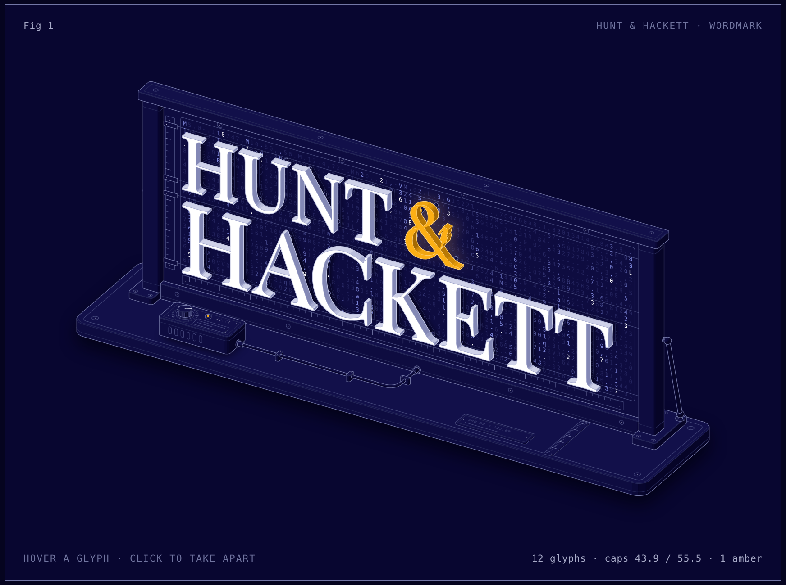
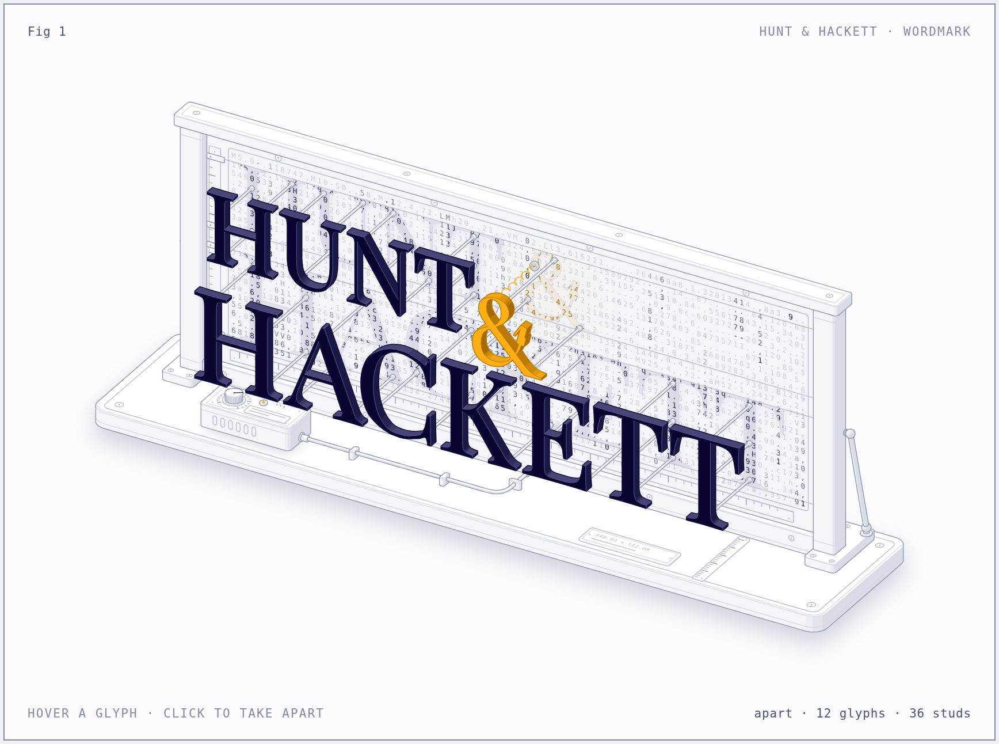

# hackett-logo

**[See it live → cozybear-dev.github.io/hackett-logo](https://cozybear-dev.github.io/hackett-logo/)**

An interactive isometric anatomy of the Hunt & Hackett wordmark. The mark is built as a stand-off sign on an assembly stand: twelve glyphs, each its own part on its own studs, in front of a navy panel. Hover a glyph and it slides out; click and the whole sign comes apart.

The panel is a display, and what falls down it is the wordmark's own source: the path data each glyph is drawn from. Slide a glyph out and it leaves its outline behind, written in its own.

[](https://cozybear-dev.github.io/hackett-logo/)

| | |
|---|---|
|  | **What it shows**<br><br>• 12 glyphs on 2 baselines, on 36 studs<br>• `HUNT &` set 43.9 tall, `HACKETT` 55.5: a ratio of 1.27<br>• 12.8 units of leading between the lines<br>• 348.93 × 112.09 overall<br>• one amber glyph, `#fcaf15`, on `#080630`<br>• 8,343 characters of path data, from 415 (`A`) to 891 (`H`) a glyph |

## Using it

| | |
|---|---|
| Hover a glyph | It slides out along its studs and the readout gives its size and how far out it stands |
| Click, or <kbd>Space</kbd> | Take the sign apart, or put it back |
| <kbd>←</kbd> <kbd>→</kbd> <kbd>Home</kbd> <kbd>End</kbd> | Step through the glyphs in reading order |
| <kbd>Esc</kbd> | Put everything back |
| The four buttons | Pull out `HUNT`, the ampersand, or `HACKETT` on their own |

Left alone, it tours itself. Under reduced motion the code stops falling and each pose is reached at once. There is a [light version](https://cozybear-dev.github.io/hackett-logo/light.html) too.

## How it is made

Every number on the page is measured from the wordmark's own outlines. `src/wordmark.mjs` flattens the logo's paths into contours and reads the cap heights, baselines and widths from them; `build.mjs` stands each glyph on a wall, extrudes it, places its studs inside its strokes, and draws the stand around it. The code on the panel is the same data, one character to a cell, with each glyph's own path behind it. Nothing is typed in by hand.

```sh
node build.mjs           # writes index.html and light.html
node build.mjs --audit   # also proves the geometry
```

Node 20.10 or later, no dependencies. The audit ray-casts every pair of parts that overlap on screen, in 1,134 poses (at rest, apart, each glyph out alone, and every frame of the springs between), and fails the build if anything is drawn in the wrong order, passes through anything, or hangs in the air.

| Path | What it is |
|---|---|
| `build.mjs` | The figure: geometry, painter's order, page |
| `src/wordmark.mjs`, `src/wordmark.json` | The outlines and the metrics read from them |
| `src/letters.mjs` | Glyphs extruded out of a wall, and where their studs go |
| `src/live.js`, `src/figure.css` | Motion, pointer and keyboard; the two themes |
| `kit/` | The drawing kit from Anatomy, vendored |

## Credits

Built with [Anatomy](https://github.com/wheresryan22/anatomy), a Claude skill for isometric figures, by [@wheresryan22](https://github.com/wheresryan22). The files in `kit/` are its drawing kit, MIT licensed; see [`kit/LICENSE`](kit/LICENSE).

This is an unofficial illustration. Hunt & Hackett and its logo are trademarks of their owner, and the outlines in `src/wordmark.json` are theirs.

Created in [T3 Code](https://t3.codes).
